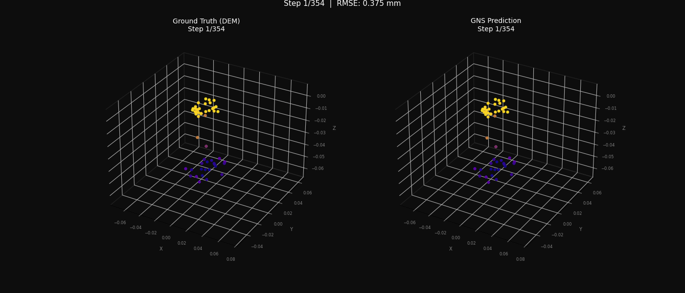
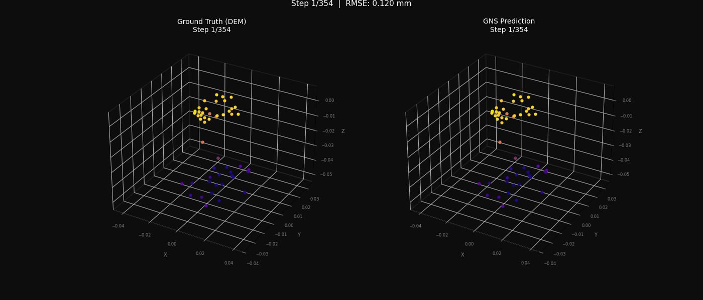
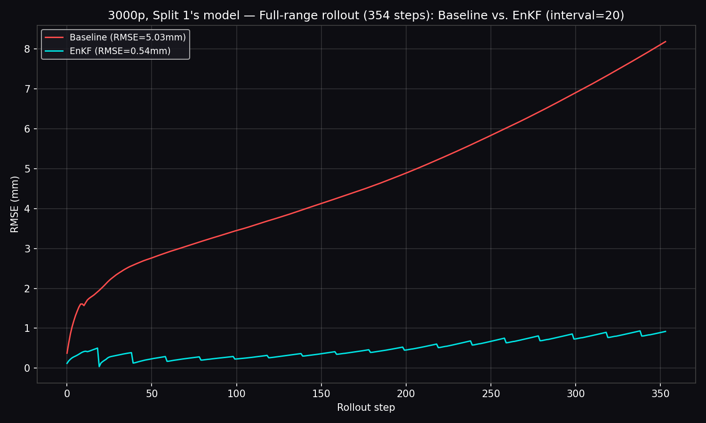
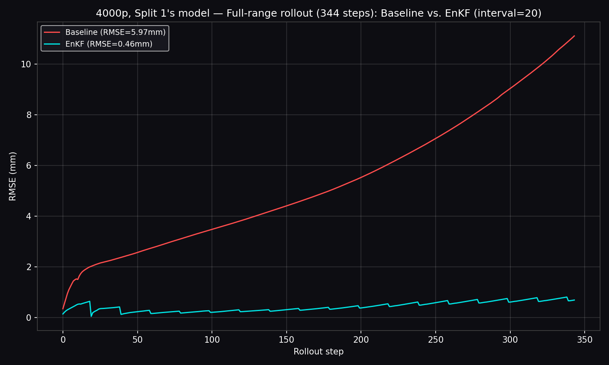
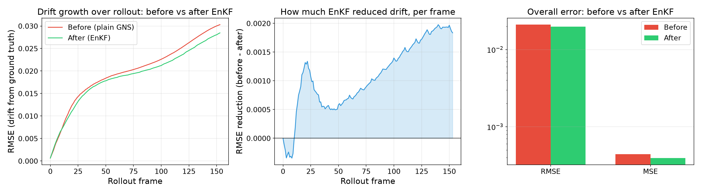
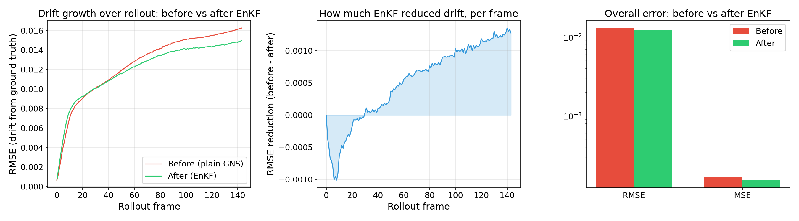

# Prediction of Particle Trajectories using AI

A Graph Network Simulator (GNS) trained as a fast surrogate for DEM
(Discrete Element Method) granular particle simulation — with an Ensemble
Kalman Filter (EnKF) correction layer that fixes the long-horizon drift
autoregressive surrogates are known for.

DEM resolves every particle contact and takes hours per run. The trained
surrogate reproduces the same behavior in seconds — but naively, its own
prediction errors compound over a long rollout. This project builds that
surrogate, honestly measures how badly it drifts, and fixes it.

## Results

### AOR (Angle of Repose — particles settling into a static pile)

Full-range autoregressive rollout (300+ steps), baseline vs. EnKF-corrected,
evaluated against DEM ground truth on data the model never trained on.

| Particles | Rollout length | Baseline RMSE | EnKF RMSE | R² (baseline → EnKF) | Improvement |
|---|---|---|---|---|---|
| 3,000 | 354 steps | 5.03e-03 m | 5.40e-04 m | 0.850 → 0.998 | **9.3x** |
| 4,000 | 344 steps | 5.97e-03 m | 4.62e-04 m | 0.790 → 0.999 | **12.9x** |

<p align="center">
  
  
  <br><em>Left: baseline GNS, no correction — drifts visibly over the rollout. Right: same model with EnKF correction (interval = 20 steps) — stays locked to ground truth.</em>
</p>

<p align="center">
  
  
</p>

### MoreFlow (active granular flow — the harder, dynamic case)

| Particles | Baseline RMSE | EnKF RMSE | Improvement |
|---|---|---|---|
| 3,000 | ~3.03e-02 | ~2.84e-02 | ~6% |
| 4,000 | ~1.63e-02 | ~1.49e-02 | ~9% |

<p align="center">
  
  
</p>

**Why the two results look so different — and why that's the interesting part:**
the two EnKF implementations deliberately made a different tradeoff. AOR's
correction observes the full particle state at every checkpoint, which
produces the dramatic 9–13x improvement above. MoreFlow's correction instead
observes only **10% of particles** at each checkpoint — a harder, more
realistic test of whether the correction generalizes from a sparse sensor
set rather than being handed the whole answer. Its smaller, more modest
improvement is the honest cost of that stricter test, not a weaker result.

## Pipeline

```
LIGGGHTS DEM simulation (AOR / MoreFlow)
        │  raw per-frame CSV output
        ▼
CSV → .npz + metadata.json          (train/test split, graph connectivity radius, normalization stats)
        ▼
GNS training                        (encode → process → decode, message-passing GNN, geoelements/gns)
        ▼
Autoregressive rollout               (baseline — predictions feed back in as the next input, errors compound)
        ▼
Ensemble Kalman Filter correction     (N-member ensemble, periodic correction toward a noisy observation)
        ▼
Evaluation + visualization            (RMSE/MAE/R² vs. DEM ground truth, side-by-side rollout GIFs)
```

Both `AOR/` and `MoreFlow/` are full implementations of this pipeline for
their respective dataset, built independently using different Kalman-gain
formulations (AOR: diagonal/localized covariance; MoreFlow: full ensemble
covariance via pseudoinverse) — see each folder's own README for the
technical detail and exact commands to reproduce.

## Repository structure

```
AOR/                   full AOR pipeline: data conversion, training invocation,
                        EnKF correction, visualization — see AOR/README.md
MoreFlow/               full MoreFlow pipeline, same shape — see MoreFlow/README.md
docs/                   result images/GIFs used in this README
AMS_Intermediate.pptx   intermediate project presentation
AMS_Final.pptx          final project presentation
```

## Tech stack

PyTorch · PyTorch Geometric · NumPy · SciPy · Matplotlib · LIGGGHTS (DEM
solver) · SLURM / NVIDIA H100 (university HPC cluster)

Built on [geoelements/gns](https://github.com/geoelements/gns), an
open-source PyTorch Graph Network Simulator (Kumar & Vantassel, 2023, JOSS),
itself based on Sanchez-Gonzalez et al. (2020), *Learning to Simulate
Complex Physics with Graph Networks* (ICML).

## Team — AMS Lab, Otto von Guericke University Magdeburg

| Domain | Contributor |
|---|---|
| AOR pipeline + EnKF | Hrishikesh Vijay Joshi |
| MoreFlow pipeline + EnKF | Jayakrishna Ajithkumar Jayasree |
| | Guru Prasad Vastrala |
| | Hari Charan Hosakote Lokesh |

## References

- Sanchez-Gonzalez, A. et al. (2020). *Learning to Simulate Complex Physics
  with Graph Networks*. ICML.
- Kumar, K. & Vantassel, J. (2023). *GNS: A Generalizable Graph Neural
  Network-based Simulator for Particulate and Fluid Modeling*. JOSS.
- [geoelements/gns](https://github.com/geoelements/gns)
